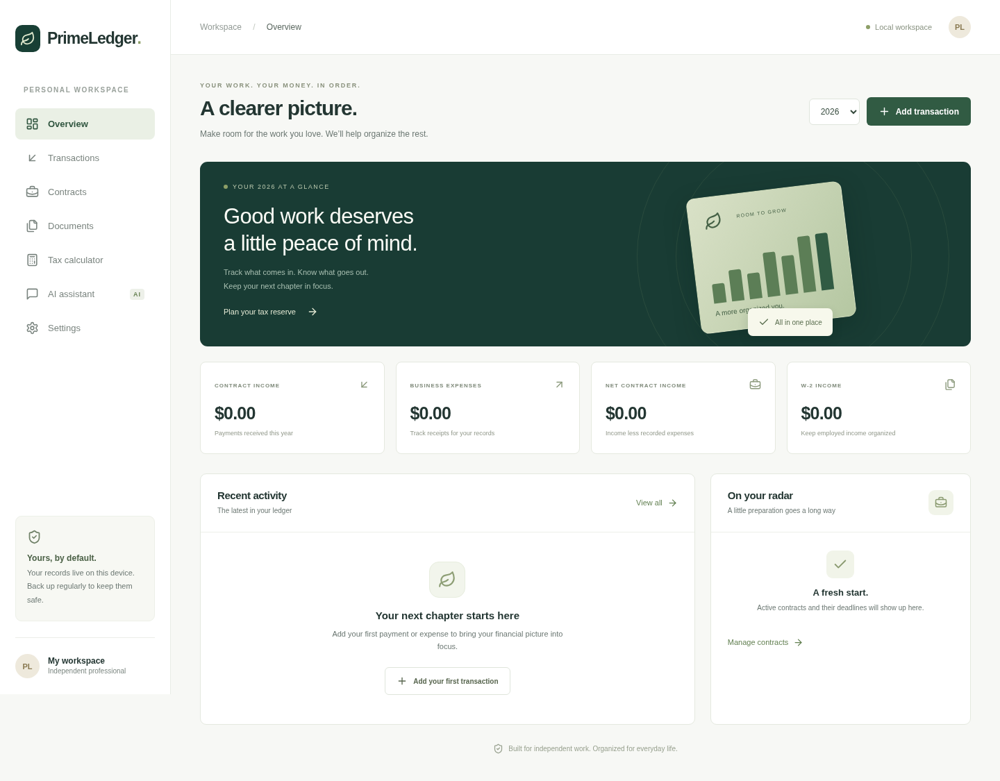

# PrimeLedger

A local-first financial workspace for independent contractors. Windows desktop via Electron; Android via Capacitor. All amounts are USD. This first release focuses on organizing records rather than tax filing or bank integrations.



## What works

- **Ledger:** create, edit, delete, search, and export 1099 payments, business expenses, and W-2 gross income. Yearly totals use integer cents.
- **Contracts:** clients, agreed values, deadlines, status, notes, and linked payments. Contract records do not generate legally binding agreements.
- **Documents:** attach agreements, receipts, invoices, 1099s, W-2s, and notes; link them to contracts. Up to 10 MB per file. Download original attachments; no PDF parsing or e-signature. Image extraction is available in the AI assistant.
- **Tax reserve calculator:** adjustable federal/state effective rates, self-employment tax, Social Security wage base, and payments already allocated. See the in-app assumptions. This is not an IRS payment schedule, return, safe-harbor calculation, or deduction eligibility determination.
- **AI chatbot:** Ollama Cloud, OpenAI, Anthropic, Gemini, OpenRouter, Groq, and custom HTTPS OpenAI-compatible endpoints. Live model discovery uses provider APIs rather than a stale model list; exact model IDs can also be entered. Availability depends on the account and endpoint. Some returned models do not support chat.
- **Screenshot extraction:** upload PNG, JPEG, or WebP receipts/payment screenshots (up to 4 MB), explicitly send to a vision-capable model, review/edit suggested fields, and save a transaction plus its original screenshot together. Nothing is saved automatically. Text extraction quality depends on the model.
- **Offline speech:** eSpeak NG and its English voice data are bundled in Electron. Read assistant replies aloud, or stop playback. No separate eSpeak installation is needed.
- **Backups:** JSON export/restore including attachments, with transactional local writes. CSV exports cover the selected year's filtered transactions. Android uses the native share sheet; Windows downloads files.
- **Updates:** installed Windows builds check GitHub Releases at startup and on request, download on request, and restart on request. Updater metadata and blockmaps are release assets.

## Development

Node.js 24 LTS and npm are required. Use the existing checkout; cloud tasks are already isolated and do not need a Git worktree.

```sh
npm ci
npm run dev          # Vite browser development
npm run build        # TypeScript + production web bundle
npm test             # finance, backups, CSV and provider protocol tests
npx playwright install --with-deps chromium
npm run test:e2e     # desktop and Android-sized browser workflows
node scripts/check-speech.mjs
npm run desktop      # production renderer inside Electron
```

For a managed cloud machine set `npm_config_cache`, `XDG_CACHE_HOME`, and `PLAYWRIGHT_BROWSERS_PATH` to writable task-owned directories if home storage is read-only. Electron installation honors `NODE_USE_ENV_PROXY=1` when the environment supplies a proxy. Do not disable TLS or checksum verification. Browser tests can use an installed Chrome binary via `CHROME_EXECUTABLE=/path/to/chrome`.

Electron requires a graphical session. For a Linux virtual display smoke test:

```sh
PRIMELEDGER_SMOKE=1 xvfb-run -a npx electron .
```

This verifies the packaged renderer loads and the preload IPC generates eSpeak audio; it does not claim Windows installation or audible speaker playback was tested on Linux.

### Windows

On Windows with Node.js 24:

```sh
npm ci
npm run dist:win
```

NSIS installer, blockmap, and `latest.yml` are generated under `release/`. Unsigned preview installers may trigger SmartScreen. Configure electron-builder's supported Windows signing credentials for trusted production distribution; credentials never belong in the repository. Updates require public GitHub release access. End users do not need GitHub tokens. Private repository distribution needs a separate authenticated update service; never embed a release token in the client. Android does not use electron-updater.

### Android

Android 7+ (API 24), Java 21, Android SDK platform 36 and compatible build tools. Set `ANDROID_HOME` to your installed SDK.

```sh
npm ci
npm run android:sync
cd android
./gradlew assembleDebug assembleRelease --no-daemon --max-workers=2
```

The debug APK can be installed for evaluation. `app-release-unsigned.apk` must be signed with your private release keystore before distribution. Keep that key secure and stable for future Android upgrades. Export a backup before switching from a debug build to a differently signed release. A physical Android device and signed Windows installation remain required for final platform acceptance.

## AI configuration and privacy

Open **AI assistant**, choose the provider, supply your own API key, refresh models, and select a text-chat model. Ollama Cloud uses `https://ollama.com/api/tags` and `/api/chat`. Other providers use their documented model and chat endpoints. Compatible providers use `/models` and `/chat/completions` beneath the configured API base. Model discovery is scoped to what the provider returns to your account, not a promise of every public model. Provider API errors are shown in the chat panel. Usage may cost money.

API keys remain in memory by default, including on Android. Electron can optionally encrypt saved keys using the OS credential service (`safeStorage`, DPAPI on Windows). Load/forget saved keys from the panel. No keys are included in backups. Browser development calls may encounter provider CORS restrictions; native Electron and Android send requests outside browser CORS through tightly scoped bridges. HTTPS is required. Custom endpoints receive the key you explicitly enter for them.

**Workspace sharing is off by default.** Turning it on sends the selected year's totals, all contract details, and document titles/notes to the selected provider for each message. Attachments and individual transactions are excluded from workspace sharing. Separately, choosing **Analyze & review** explicitly sends the selected screenshot to the provider even with workspace sharing off. You can paste relevant text yourself, but only share information you intend that provider to receive. The assistant cannot modify saved records or read stored attachments. Screenshot extraction reads only the image you explicitly submit, and saving still requires your review. Chat history is session-only and clears when leaving the assistant.

Financial records and attachments are stored in IndexedDB on the device, without app-level encryption. Secure the device and export backups regularly. Backups contain sensitive records in plaintext. Android OS backup is disabled. The Windows and Android workspaces do not sync automatically; transfer a JSON backup manually. Restore replaces the current workspace after confirmation, so export first. CSV is an export format, not a restorable backup. Clearing app data or uninstalling may permanently delete local records. Use a tax professional for personal tax guidance and a lawyer for agreement review.

## Release automation

The `Validate and release` workflow validates pushes/PRs. Pushing a version tag such as `v0.1.1` runs validation, builds Windows and Android artifacts, and then creates a GitHub release with SHA-256 checksums. Publication waits for both builds to succeed. GitHub Actions must be enabled and allowed to write repository contents. Source archives are supplied by GitHub. See [release notes](RELEASE_NOTES.md) for signing and preview limitations.

## Licensing

GPL-3.0-or-later. See [LICENSE](LICENSE) and [third-party notices](THIRD_PARTY_NOTICES.md), including the bundled GPL eSpeak NG port. Dependency versions and integrity hashes are recorded in `package-lock.json`.
